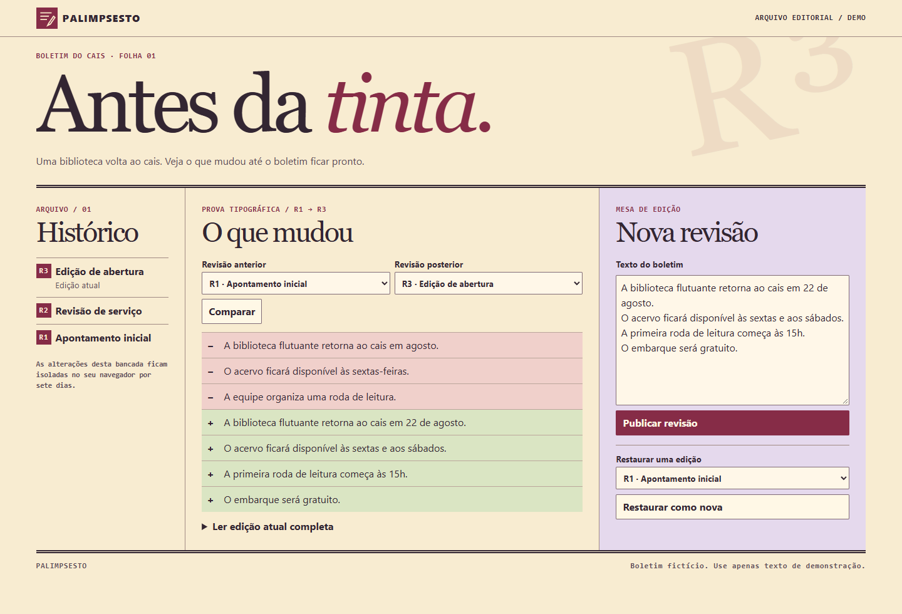

# Palimpsesto

Uma bancada editorial para o boletim fictício de uma biblioteca flutuante. Escolha duas revisões, veja linhas adicionadas e removidas, publique uma edição ou restaure um texto antigo como nova revisão.



O [histórico de páginas da Wikipédia](https://en.wikipedia.org/wiki/Help:Page_history) inspirou a comparação e a restauração com preservação do histórico. O boletim e a composição inspirada em provas tipográficas são próprios.

Hono renderiza o HTML no servidor e htmx atualiza a bancada. SQLite/D1 protege publicações concorrentes com uma gravação condicional. Se outra aba publicar primeiro, o rascunho fica no editor para revisão. As três primeiras revisões são fictícias e as próximas ficam isoladas por sessão por até sete dias.

## Rode localmente

Node.js 24 e npm.

```sh
npm ci
npm run build
npm start
```

Abra http://127.0.0.1:4173. O banco local fica em `.local/palimpsesto.sqlite`.

```sh
npm test
npx playwright install chromium
npm run test:browser
```

[Contrato de integração](docs/solution-contract.md)
